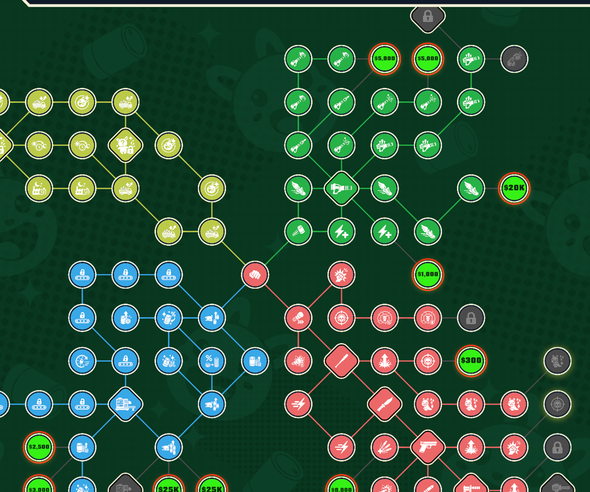
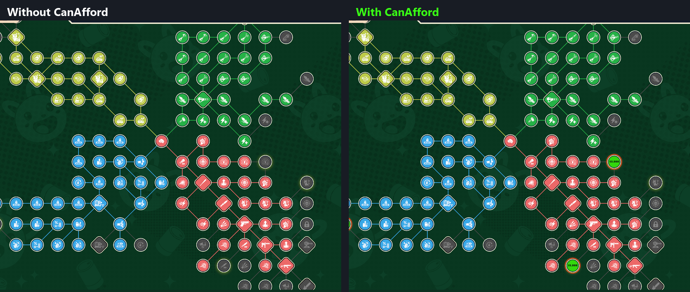
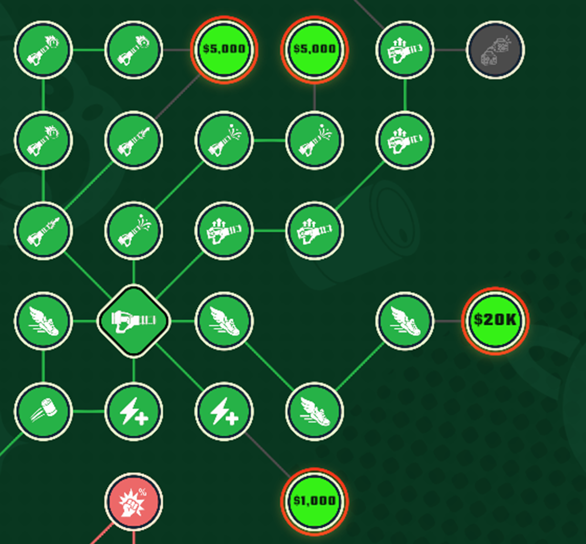

<p align="center">
  
</p>

<h1 align="center">CanAfford – Can 'Em All mod</h1>

<p align="center">
  MelonLoader mod for <b>Can 'Em All</b> (Steam, by LuisDev).<br>
  Every skill you can buy <b>right now</b> lights up in the skill tree – neon green, red border, price in the middle.
</p>

<p align="center">
  <a href="../../releases/latest"></a>
  <a href="../../releases"></a>
  
  <a href="LICENSE"></a>
</p>

<p align="center">
  <a href="../../releases/latest"><b>⬇ Download CanAfford</b></a> · <a href="https://steamcommunity.com/sharedfiles/filedetails/?id=3838187911">Steam guide</a> · <a href="https://github.com/Yukitus86/can-em-all-savegame-editor">Savegame editor</a>
</p>

<p align="center">
  
</p>

Unofficial fan mod, not affiliated with LuisDev. It only changes how the skill tree looks –
your save is never touched.

## What it does

Every skill in the skill tree that you can buy **right now** turns neon green, gets a red
border and shows its **price in the middle** instead of the icon, gently pulsing. You see at a
glance what you can afford – no more searching the whole tree.



<p align="center">
  
</p>

"Can buy right now" means:

- not purchased yet,
- all requirements purchased (the game's own check, `SkillNode.AreRequirementsMet`),
- not locked for the demo,
- price ≤ your current money.

The marking updates live when money changes or a skill is bought. Optional: affordable
permanent prestige upgrades (upgrade points instead of money, the game's own
`PermanentUpgrade.CanPurchase`) get the same color.

Everything is drawn on the node's own graphics (background color + a price text inside it), so
it zooms, pans and fades together with the tree. The game's look is restored as soon as a skill
is no longer affordable or bought. Nothing is written to your save.

## Installation

1. **Back up your save** (optional, the mod never touches it):
   `%USERPROFILE%\AppData\LocalLow\LuisDev\Can 'Em All\save.sav`
2. Install **MelonLoader 0.7.3 or newer** (x64):
   download `MelonLoader.Installer.exe` from
   <https://github.com/LavaGang/MelonLoader/releases>, select
   `Can 'Em All.exe` (Steam → right-click the game → Manage → Browse local files) and press *Install*.
   Or unpack `MelonLoader.x64.zip` into the game folder (`version.dll` + `MelonLoader\`).
3. Start the game once and let MelonLoader finish its first-run setup (console window,
   takes a minute), then quit.
4. Copy `CanAfford.dll` into the game's `Mods\` folder.
5. Start the game. The MelonLoader console shows `CanAfford loaded`.

Uninstall: delete `Mods\CanAfford.dll`. To remove MelonLoader completely delete
`version.dll`, `MelonLoader\`, `Mods\`, `Plugins\`, `UserData\`, `UserLibs\` from the game folder.

## In game

| Key | Action |
|-----|--------|
| **F7** | Marking on / off |
| **F8** | Write the list of affordable skills (+ permanent upgrades) to the MelonLoader console/log |

## Settings

`UserData\MelonPreferences.cfg` (created on first start), section `[CanAfford]`.
Changes are picked up **live** while the game runs (within a second).

| Setting | Default | Meaning |
|---------|---------|---------|
| `Enabled` | `true` | Marking on/off (also toggled with F7) |
| `PermanentUpgrades` | `true` | Also color affordable permanent upgrades |
| `Style` | `"Fill"` | `Fill` = whole node colored, `Outline` = outline only, `Both` |
| `FillColor` | `"#39FF14"` | Node color |
| `ShowPrice` | `true` | Show the price instead of the icon |
| `PriceColor` | `"#0B1A0B"` | Price text color |
| `PriceSize` | `0.62` | Price text box size relative to the node (0.3 – 0.9) |
| `PriceDollar` | `true` | `$` in front of the price |
| `PriceOffsetX` / `PriceOffsetY` | `0` | Nudge the price (fraction of node size, + = right / up) |
| `Border` | `true` | Colored border around marked nodes |
| `BorderColor` | `"#FF1A1A"` | Border color |
| `BorderSize` | `0.08` | Border width relative to the node size |
| `Color` | `"#40FF59"` | Outline color for `Outline`/`Both`, `#RRGGBB` or `#RRGGBBAA` |
| `Thickness` | `4.0` | Outline thickness in UI pixels |
| `Pulse` | `true` | Gentle pulsing (color + price size) |
| `PulseSpeed` | `1.0` | Pulse speed |
| `ToggleKey` / `DumpKey` | `F7` / `F8` | Input System key names |

Price format: `$850`, `$1,000`, `$25K`, `$1.5M`, `$667M`.

## Building from source

Requirements: .NET SDK 6 or newer, and MelonLoader installed in the game with the first run
done (the build references `MelonLoader\net6\*` and `MelonLoader\Il2CppAssemblies\*`).

```bash
dotnet build -c Release
```

The DLL is copied to `<game>\Mods` automatically (only while the game is closed). Other game
location:

```bash
dotnet build -c Release -p:GameDir="D:\SteamLibrary\steamapps\common\Can 'Em All"
```

Skip the copy with `-p:DeployToGame=false`.

## How it works

- Harmony postfix on `SkillNode.Update` (only runs while the tree is open): checks
  `skill.isPurchased`, `IsLockedForDemo()`, `AreRequirementsMet()` and
  `skill.price <= MoneyManager.Instance.Money`.
- Affordable: `SkillNode.background` is tinted, `SkillNode.icon` hidden and a
  `TextMeshProUGUI` child of the background shows the price (font taken from the game's own
  skill popup). Previous colors are remembered and put back unless the game set new ones itself
  (e.g. its "purchased" color).
- Requirements: all listed requirements must be purchased (verified against the save data).
- Harmony postfix on `PermanentUpgrade.Update`: color only, with `!IsPurchased && CanPurchase`.
- If a game update renames these, the mod logs one error and does nothing else.

- Border: a copy of the node's own fill shape (circle / diamond), red and slightly bigger,
  placed behind all of the node's graphics, so only the rim outside the node shows.

Developer helper: create an empty file `UserData\CanAfford_dump.txt` while the game runs →
the affordable list and one node's GameObject hierarchy are written to the log.

Tested with game build 26596503 (Unity 6000.2.15f1), MelonLoader 0.7.3.
